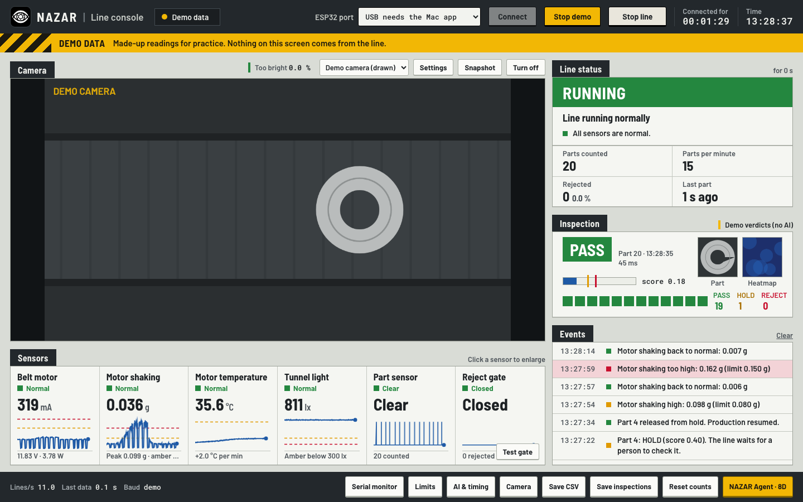

# NAZAR Console

The offline Mac app for the NAZAR washer inspection line (Team Parakh, INDUX 5.0, PS-04). It reads the ESP32's sensors
over USB, photographs every washer that stops under the camera, asks the local AI for PASS / HOLD / REJECT, tells the
ESP32 the verdict (the gate pushes bad parts off), shows everything live to the operator, and opens a root-cause 8D
report from the local agent. No internet is needed at any point.

```
ESP32 (nazar-firmware) ──USB serial 115200, JSON lines──▶ NAZAR Console ──HTTP 127.0.0.1:8765──▶ nazar-vision
                       ◀────────── text commands ─────────               ──HTTP 127.0.0.1:8766──▶ nazar-agent
```

Interfaces follow `../nazar/CONTRACT.md` (v2).



## Build

Needs only the Xcode Command Line Tools (`xcode-select --install`). No Xcode project.

```bash
cd app && ./build.sh
```

Output: `build/NAZAR Console.app` (Apple Silicon + Intel, macOS 12+) and `build/NAZAR-Console-mac.zip`.
The app is signed ad-hoc with `designated => identifier "com.teamparakh.nazar-console"`, so macOS keeps the camera
permission across rebuilds. On a teammate's Mac: right-click the app › Open › Open, or `xattr -cr "NAZAR Console.app"`.

## Run

1. Upload the firmware, close the Arduino Serial Monitor (the port is exclusive).
2. Open **NAZAR Console**, pick the `cu.usbserial…` port, press **Connect**. Next time it connects by itself, and it
   reconnects by itself after an unplug. The ESP32 restarts when the port opens; the console keeps its own counts.
3. The first time, macOS asks for the camera. Allow it. Pick the camera above the picture.
4. Press **Start AI** (or double-click `Start Vision.command` and `Start Agent.command`). The Inspection panel shows
   "AI ready · 52 ms". Without the AI the line still runs: every part is logged as SKIPPED and passed.
5. Run the belt for 10 s, then **Limits › Learn normal from last 10 s**.
6. **Camera › Settings**: switch off automatic exposure (this also fixes gain) and aim for **0 % Too bright**. On the
   Logitech C270 under the tunnel lamp, about 1.5 ms with gain 0. Mains frequency 50 Hz.

No hardware? Press **Demo data**: a pretend board in the page speaks the same protocol, with a drawn demo camera and
made-up verdicts. A yellow band says DEMO DATA the whole time and demo readings are never mixed with real ones.

## Test without hardware

```bash
python3 tools/sim_board.py            # prints e.g. /dev/ttys004
open -n -a "build/NAZAR Console.app" --env NAZAR_EXTRA_PORT=/dev/ttys004 --stderr /tmp/nazar-console.log
```

`tools/sim_board.py` is a pretend ESP32 on a pseudo-terminal (Python standard library). It sends telemetry at 10 Hz,
`part` / `inspect` / `go` / `gate` messages, answers every command, and prints `received: …` for each one, so you can
check what the console sent. Options: `--loose-every 60` (motor-mount episode: shaking past amber and red),
`--drop-light-at 25` (light sensor gone for 8 s), `--reboot-at 40` (board restart), `--quit-at 75` (cable pulled),
`--stops 0` (continuous mode).

`tools/mock_ai.py` stands in for the vision and agent services (contract-shaped answers). `--slow 3` makes the vision
answer late, to see the 2 s timeout pass the part.

Test hooks (environment variables of the app):

| Variable | Effect |
|---|---|
| `NAZAR_EXTRA_PORT=/dev/ttysN` | adds the simulator port to the port list |
| `NAZAR_AUTOCONNECT=/dev/ttysN` | connects to it at launch (no click needed) |
| `NAZAR_NO_CAMERA=1` | leaves the camera off (no permission prompt in automated tests) |
| `NAZAR_WEB_DIR=/path/to/web` | loads the screen from the working copy instead of the bundle |

The screen also runs in a normal browser: `web/index.html?demo=1`. Add `&realai=1` to send demo photos to the real
vision service, and `&show=agent|limits|serial|ai|camera|detail&after=20000` to open a view (for screenshots).

## Screen tour

- **Title bar**: eye logo, "NAZAR | Line console", connection pill, ESP32 port picker (USB ports first; Bluetooth and
  debug ports hidden), Connect / Disconnect, Demo data, **Stop line** (sends `STOP`; ink on bone, not red: it is not an
  emergency stop), connected-for time and clock.
- **Status band** (striped yellow, always there): LIVE DATA / DEMO DATA / NOT CONNECTED / CONNECTION LOST.
- **Camera**: the live picture only, nothing drawn on it. Camera picker (remembered), Settings, Snapshot (PNG),
  Turn off / on, click to enlarge (Esc closes). The **Too bright** meter is the share of pure-white pixels in the middle.
- **Sensors**: Belt motor (mA, V, W), Motor shaking (g RMS and peak), Motor temperature (with °C per minute), Tunnel
  light (lx), Part sensor, Reject gate (Test gate sends `REJECT`). Each shows value, status word and a 60 s sparkline
  with amber and red lines; "No signal" when the key has been missing for 3 s. Click for **Sensor detail**: 30 s to
  15 min, Pause (Space), ← → to step, stats, switch sensor keeping the pause.
- **Line status**: one big word — RUNNING, INSPECTING, CHECK SOON, STOP & CHECK, ON HOLD, STOPPED, NO DATA, NOT
  CONNECTED — with a plain-language headline and steps. On HOLD: the held part's crop and heatmap and a green
  **Resume production** key (`RESUME`). After Stop line: a green **Start line** key (`START`). Counts: parts, parts per
  minute, rejected (%), last part.
- **Inspection**: last verdict, score bar with hold and reject marks, crop and heatmap, last 12 parts, PASS / HOLD /
  REJECT counts, AI state.
- **Events**: alarms raised and cleared, no signal, holds, rejects, connect / disconnect, "Two-way link OK", limit changes.
- **Keys**: Serial monitor, Limits, AI & timing, Camera, Save CSV, Save inspections, Reset counts, **NAZAR Agent · 8D**.

## How it decides

- **Alarms**: each sensor is judged on the median of its last second; a new state must hold 1 s before it shows.
  Defaults: belt 700 / 1000 mA (stopped below 40 mA while it should run), shaking 0.08 / 0.15 g, temperature 45 / 60 °C,
  light below 300 / 120 lx. Learn normal sets belt 1.6× / 2.4×, shaking max(2×, +0.02) / max(3.5×, +0.05), light
  0.6× / 0.35× of the last 10 s.
- **Inspection loop**: on `{"t":"inspect","n":…}` wait the settle time (300 ms), grab the video frame as JPEG, POST it to
  `/inspect` with a 2 s timeout, send `PASS` / `FAIL` / `HOLD`. NO_PART, AI offline, an error or a timeout are logged
  and answered with `PASS`: **the line never waits on the AI**. With `stops 0` firmware the belt keeps running, the
  same `inspect` message arrives, the same verdict is sent, and no `go` follows.
- **Timing**: stop_ms, dwell_ms, wait_ms, gate_ms, gate_open_ms and stops are saved in the console and sent with
  `SET` whenever the board's `hello` reports a different value (so after every connect and every reboot).
- **Stop line** is put back with `STOP` after a board reboot or reconnect (the firmware boots in RUN).
- **Inspection log** (Save inspections, and what the agent receives): `at, n, verdict, score, ms, v, ma, vib, vpk, lux,
  temp`. Light and temperature are the values at the photo. Because the belt is stopped at the photo, `v`, `ma`, `vib`
  and `vpk` are the median of the last second the belt was running before the stop (otherwise they would always read
  "motor off"). Skipped parts are in the CSV with their reason as the verdict (`AI_OFFLINE`, `TIMEOUT`, `NO_CAMERA`,
  `AI_ERROR`, `AI_OFF`, `NO_PART`); only PASS / HOLD / REJECT rows go to the agent.
- **8D**: English only for now (`"lang":"en"`). Mark fix applied sets `fix_at`; the next draft compares before and
  after. Without the agent, Demo data gets a console-made template report, clearly marked.

## Files

| Path | What |
|---|---|
| `app/Sources/SerialPort.swift` | POSIX serial: termios raw 8N1, TIOCEXCL, IOSSIOSPEED, DispatchSourceRead, unplug detection, port list |
| `app/Sources/Bridge.swift` | page ⇄ Mac messages (serial, save panel, camera controls, Start AI, keep display awake) |
| `app/Sources/CameraControls.swift` | webcam exposure / gain / mains frequency through CoreMediaIO |
| `app/Sources/AppDelegate.swift`, `Menu.swift`, `main.swift`, `Settings.swift` | window, WKWebView setup, camera permission, menu, settings |
| `app/make_icon.swift`, `app/build.sh` | icon and build |
| `web/index.html`, `web/css/*.css` | the screen and its machine-panel look (light and dark) |
| `web/js/*.js` | util, store, bridge, demo, link, alarms, charts, camera, inspect, csv, ui-*, agent, main |
| `tools/sim_board.py`, `tools/mock_ai.py` | simulator board and mock AI services |
| `docs/console.md` → `docs/NAZAR-04-Console-App.pdf` | plain-language explainer |

## Not verified yet

- With the real ESP32 firmware and the real C270 camera on the rig (verified with `sim_board.py`, Demo data,
  `mock_ai.py`, and the native app against the simulator without a camera).
- Camera settings through CoreMediaIO were compiled but not exercised in this build (no webcam attached during the test).
- The native save panel, Start AI (opening the `.command` files) and camera permission prompt were not clicked through.
