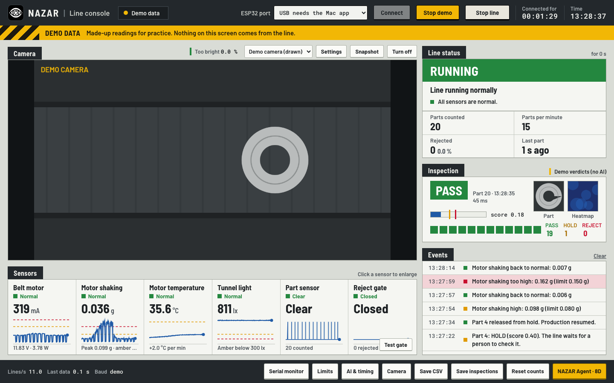
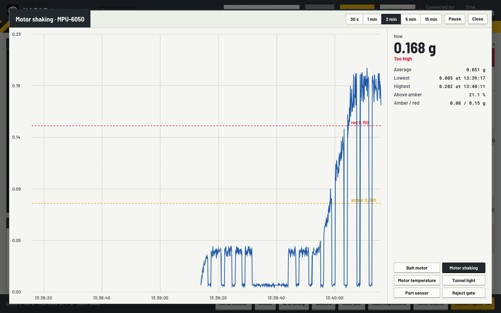

# NAZAR Console — Mac App

> How the operator screen talks to the ESP32, the camera and the local AI, and why each technology was chosen.

## 1. What the app does

NAZAR Console is the program the operator looks at. It runs on one Mac, next to the line, with no internet. It has
five jobs:

1. **Listen to the ESP32.** Ten times a second the board sends one line of sensor readings over the USB cable: belt
   motor current and voltage, how much the motor shakes, the motor temperature, the light in the camera tunnel, the
   part sensor, the reject gate, and the line mode.
2. **Photograph every washer.** When a washer has stopped under the camera, the board says so. The app takes a photo
   from the live camera picture.
3. **Ask the AI.** It sends the photo to the vision service on the same Mac and gets back PASS, HOLD or REJECT.
4. **Tell the board.** It sends `PASS`, `FAIL` or `HOLD` back down the cable. On FAIL the ESP32 fires the reject gate.
5. **Explain.** It shows everything in plain language, keeps a log of every inspected part, and opens the 8D
   root-cause report written by the local agent.



The screen is split like a machine control panel: the camera and six sensor tiles on the left; on the right the
**Line status** (one big word such as RUNNING or STOP & CHECK, with what to do), the **Inspection** panel (last
verdict, score, photo and heatmap) and the **Events** list. A striped yellow band at the top always says where the
numbers come from: LIVE DATA, DEMO DATA, NOT CONNECTED or CONNECTION LOST.

## 2. Two halves: Swift outside, a web page inside

The app is a **hybrid**. The outside is a small native Mac program written in **Swift** with **AppKit** (Apple's
classic toolkit for windows and menus). Inside its one window sits a **WKWebView** — the same engine as Safari — which
shows an HTML page that draws the whole screen.

Why split it like this?

- **Swift can do what a web page cannot**: open a USB serial port, change the webcam's exposure, show a Save dialog,
  keep the display awake, open the AI start-up files.
- **HTML, CSS and JavaScript are the fastest way to draw a rich screen** and change it during a hackathon. The page
  also runs in a normal browser in Demo mode, so a teammate can work on the screen without the Mac app or the board.

Everything the page needs is inside the app: the fonts (Barlow, Barlow Semi Condensed, Roboto Mono) are bundled as
files, there are no libraries from the internet, no bundler and no build step for the page. It is plain `<script>`
files loaded in order from `file://`.

The app is built by `app/build.sh` with `swiftc` (the Swift compiler from the Command Line Tools) — no Xcode project.
It compiles twice, for Apple Silicon and for Intel, and joins both into one program with `lipo`.

## 3. The bridge between JavaScript and Swift

The page and the Swift side talk with small messages:

```
page → Mac:  window.webkit.messageHandlers.nazar.postMessage({cmd: "open", path: "/dev/cu.usbserial-0001", baud: 115200})
Mac → page:  window.NazarNative.opened("/dev/cu.usbserial-0001")
             window.NazarNative.data("{\"t\":\"tel\",\"ma\":312.4, ...}\n")
```

`Bridge.swift` receives the page's messages (open, close, write, saveFile, camSet …) and answers by running a tiny
piece of JavaScript in the page. In the page, `bridge.js` hides the difference: the rest of the code calls
`N.bridge.write("PASS\n")` and does not care whether it runs inside the app or in Chrome.

Settings (limits, timing, last port, camera, AI addresses) are kept by macOS in **UserDefaults** as one JSON text. The
app injects them into the page *before* any script runs, so the very first frame already uses the saved limits.

## 4. The serial port (USB to the ESP32)

The ESP32 appears on the Mac as a file such as `/dev/cu.usbserial-0001`. `SerialPort.swift` opens it with plain
**POSIX** calls — the same Unix functions any C program would use:

- `open()` opens the file for reading and writing.
- **termios** puts it in **raw 8N1** mode: 8 data bits, no parity, 1 stop bit, and no "helpful" processing — no echo,
  no line editing, no changing of `\r` and `\n`. Without raw mode the Mac would treat the board like a keyboard.
- **TIOCEXCL** (exclusive access): no other program may open the port while we have it. Two programs reading one port
  would each get half the bytes. This is also why the Arduino Serial Monitor must be closed.
- **IOSSIOSPEED** sets any baud rate exactly (115200 here).
- A **DispatchSourceRead** wakes the program whenever bytes arrive, so it never wastes time polling.

**Unplug detection.** If a read returns 0 bytes or an error, the device is gone (cable pulled, board reset hard, or
the simulator quit). The port is closed and the page shows CONNECTION LOST. Every 1.5 s the page asks for the port
list again; when the same port reappears it reconnects by itself.

**The ESP32 restarts when the port opens** (the USB chip pulls its reset line). So its own part counters start at 0
again. The console keeps its **own totals**: it adds up how much the board's counters went up since the last line,
and when a counter suddenly goes down it knows the board rebooted.

## 5. JSON lines: understanding what the board says

Every line from the board is one **JSON** object with a type field `t`:

```
{"t":"tel","ms":183402,"v":11.92,"ma":312.4,"vib":0.042,"vpk":0.110,"lux":812.5,"temp":34.6,"ir":0,"parts":17,"rej":3,"gate":0,"belt":1,"mode":"RUN"}
{"t":"inspect","n":18}
{"t":"go","n":18,"res":"pass"}
```

`link.js` collects the bytes, cuts them at each newline, and tries `JSON.parse` on each line. Lines that are not JSON
(the ESP32 prints boot noise after every reset) or have an unknown type are shown in the Serial monitor and otherwise
ignored, so a garbled line can never crash the screen. A sensor that fails is simply missing from the line; after
3 seconds without its key the tile says **No signal**.

Commands back to the board are plain text lines: `PASS`, `FAIL`, `HOLD`, `RESUME`, `STOP`, `START`, `REJECT`,
`PING`, `SET gate_ms 800`. When the board's `hello` message reports timing values that differ from the console's
saved ones, the console sends `SET` for each — so after every connect and every reboot the board runs with the
team's timing.

## 6. The camera

The live picture uses the web standard **getUserMedia**: the page asks for a camera and gets a video stream, which a
`<video>` element shows. Nothing is drawn on top of it — the operator sees exactly what the AI sees.

Three things were needed to make this work inside the app, because a page loaded from `file://` is not a "secure"
web page:

- two hidden WebKit settings (`mediaDevicesEnabled`, `mediaCaptureRequiresSecureConnection = false`) allow the camera
  for a local page;
- a **WKUIDelegate** method answers the page's camera request, after macOS has asked the user once;
- `NSCameraUsageDescription` in the app's Info.plist is the sentence macOS shows in that question.

**Exposure control (CoreMediaIO).** A web page can show the camera but not change its exposure. On the rig the
Logitech C270 on automatic exposure made the shiny washer face 100 % pure white, so the AI could not see marks on it.
`CameraControls.swift` uses Apple's **CoreMediaIO** to reach the camera's own UVC controls: exposure, gain, mains
frequency and more. A fixed exposure of about 1.5 ms with gain 0 fixed it. Two details matter: switching automatic
exposure off must also fix the gain (otherwise the camera brightens the picture by turning up gain instead), and the
mains frequency should be **50 Hz in India**, or the lamp flickers in the picture. Webcams forget these settings when
unplugged, so the app saves them per camera name and puts them back each time the camera starts.

The **Too bright** meter samples the middle of the picture twice a second and shows the share of pure-white pixels.
Aim for 0 %.

## 7. Charts on a canvas

The sparklines in the tiles and the big chart in Sensor detail are drawn by hand on an HTML **canvas** (`charts.js`)
— no chart library. Each chart has one blue data line, a dashed amber line and a dashed red line for the limits.
Fifteen minutes is 9 000 readings, more than there are pixels across, so for each pixel column only the lowest and
highest reading are drawn: the chart looks the same and draws quickly.

## 8. The inspection loop: the line never waits on the AI

```
inspect n  →  wait 300 ms (washer stops wobbling)  →  grab frame as JPEG  →  POST to 127.0.0.1:8765/inspect (2 s limit)
           →  PASS / FAIL / HOLD down the cable
```

- **PASS** → `PASS`: the belt restarts after the stop time.
- **REJECT** → `FAIL`: the belt restarts and the ESP32 fires the gate when the washer reaches it.
- **HOLD** → `HOLD`: the belt stays stopped. Line status shows the held washer's crop and heatmap and a green
  **Resume production** key.
- **No washer found, AI not running, an error, or no answer within 2 s** → logged and answered with `PASS`.

The 2-second limit is enforced with an `AbortController` on the HTTP request. The firmware has its own safety net too:
with no verdict at all after `wait_ms` (5 s) it lets the part go. So a crashed or slow AI can never stop production;
it only means some parts pass unchecked, and the Events list says so.

With `stops 0` (continuous belt) the same `inspect` message arrives when the washer passes the camera; the belt does
not stop, the same verdict is sent, and the ESP32 times the gate.

Each inspected part becomes one row of the **inspection log**: time, part number, verdict, score, AI time, and the
sensor values. Light and temperature are taken at the photo. Because the belt is stopped at the photo, motor current
and shaking are taken from the last second the belt was running — the conditions the washer actually travelled in,
which is what the root-cause statistics need.

## 9. Alarm logic: median, hold time, learn normal

Raw sensor readings jump around. If every spike raised an alarm the operator would stop trusting the screen. So:

- **Median of the last second.** Each sensor is judged on the middle value of its last 10 readings. One spike cannot
  move a median.
- **A new state must hold for 1 second** before it shows. A value sitting right on the limit does not flicker.
- **Amber** means check soon, **red** means stop and check. Light alarms when it is *below* its limits.
- **Learn normal from last 10 s** sets the limits from the line's own normal running: belt 1.6× and 2.4× normal current,
  shaking 2× (at least +0.02 g) and 3.5× (at least +0.05 g), light 0.6× and 0.35× normal.

The Line status picks one word by priority: not connected, no data, a red alarm, on hold, stopped, an amber alarm,
inspecting, running — and writes the reason as an instruction, for example "Motor is shaking more than normal. Check
the motor mount screws."

## 10. The NAZAR Agent · 8D view

The key at the bottom right sends the inspection log and the limits to the agent service (127.0.0.1:8766). The agent
works out the statistics and has a local language model write an **8D report** (D1 team to D8 closure). The console
shows the report on the left and the evidence on the right:

- a **p-chart**: the defect rate in groups of 20 parts, with its upper control limit;
- a **strata table**: the defect rate while each sensor was past its amber limit against normal, with the ratio and a
  **p-value** (below 0.05 means the difference is unlikely to be chance) — this is where "rejects rise when the motor
  shakes" comes from;
- **before / after**: press **Mark fix applied** after fixing the cause, run the line, and draft again.

The model needs 15–30 s, so the view shows a waiting counter; it gives up after 4 minutes. The report is English only
for now. **Approve** stamps it, **Save HTML** saves it with the chart.

## 11. Offline by design

Nothing leaves the Mac. The fonts are files in the app. The AI services listen only on 127.0.0.1 (this computer). For a
page loaded from `file://` to call `http://127.0.0.1`, the app's Info.plist sets `NSAllowsLocalNetworking` — Apple's
switch for "plain HTTP to this computer is fine".

## 12. Signing and the camera permission

macOS remembers which app was allowed to use the camera by the app's **code signature**. We have no paid Apple
developer certificate, so `build.sh` signs **ad-hoc** (`codesign --sign -`). Normally every rebuild would look like a new
app and macOS would ask again. Adding the requirement `designated => identifier "com.teamparakh.nazar-console"` tells
macOS to recognise the app by its bundle name, so the permission survives rebuilds.

## 13. Demo mode

**Demo data** starts a pretend ESP32 inside the page (`demo.js`). It speaks exactly the same JSON lines and commands,
so the real parser, alarms, inspection loop and screen run unchanged. Every 90 s the "motor mount works loose" and the
shaking climbs past amber and red; demo verdicts are about 85 % PASS, 8 % HOLD, 7 % REJECT, with more rejects while it
shakes, so the 8D view has a real pattern to find. Mark fix applied stops the episodes. Without a webcam a drawn demo
camera shows washers on a belt. Switching between demo and live always clears the data, and the band says DEMO DATA,
so made-up numbers are never mistaken for real ones.

## 14. Build, run, test

```bash
cd app && ./build.sh                       # → build/NAZAR Console.app and a zip
python3 tools/sim_board.py                 # pretend ESP32, prints /dev/ttysN
open -n -a "build/NAZAR Console.app" --env NAZAR_EXTRA_PORT=/dev/ttysN --stderr /tmp/console.log
python3 tools/mock_ai.py                   # pretend vision + agent services (optional)
```

`sim_board.py` prints every command it receives (`received: PASS`), so you can see the console's decisions. It can
also simulate a loose motor mount, a missing light sensor, a board reboot and a pulled cable.

## 15. What was tested, and what was not

Tested during the build:

- every JavaScript file passes `node --check`; the Swift code builds with warnings treated as errors;
- the screen in headless Chrome at 1440 × 900 and 1920 × 1080, light and dark;
- the built app against `sim_board.py`: connect, two-way link check, timing sync, a PASS for every washer with the
  camera off, shaking alarms raised and cleared, the light sensor disappearing and coming back, a board reboot, a
  pulled cable (CONNECTION LOST) and automatic reconnect;
- in the browser: AI offline and AI too slow (both pass the part), verdicts and images from a mock vision service,
  the 8D view from a mock agent, continuous mode, Stop / Start and Hold / Resume.

Not yet tested:

- the real ESP32 firmware and the real C270 camera on the rig;
- the CoreMediaIO camera settings in this build (no webcam was attached);
- the real vision model and the real agent with its language model;
- clicking through the macOS camera prompt, the Save dialog and Start AI in the built app.


